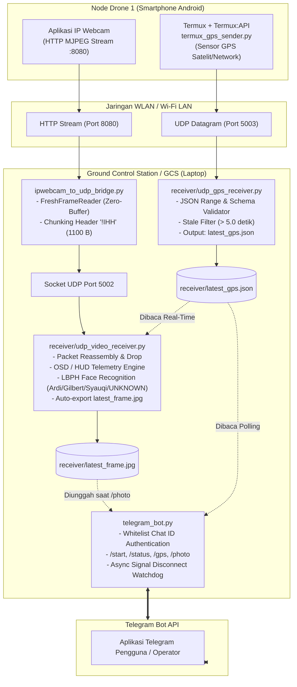

# DOKUMENTASI LENGKAP PROYEK SISTEM MONITORING DRONE 1
## Real-Time UDP Video Streaming, GPS Telemetry, OSD HUD, LBPH Face Recognition, dan Bot Telegram Terintegrasi

---

**Mata Kuliah:** Jaringan Komputer Lanjut  
**Repositori GitHub:** [Jaringan_komputer_lanjut](https://github.com/YooowwMann/Jaringan_komputer_lanjut.git)  
**File Dokumentasi:** `DOKUMENTASI_LENGKAP_PROYEK.md`  

---

## DAFTAR ISI

1. [Gambaran Umum Proyek](#1-gambaran-umum-proyek)
2. [Arsitektur Sistem dan Topologi Jaringan](#2-arsitektur-sistem-dan-topologi-jaringan)
3. [Spesifikasi Protokol Komunikasi Data](#3-spesifikasi-protokol-komunikasi-data)
   - 3.1 Protokol Video UDP (Port 5002 - Header Biner `!IHH`)
   - 3.2 Protokol Telemetri GPS UDP (Port 5003 - JSON)
   - 3.3 Penanganan Latensi: *Zero-Buffer Frame Reader*
4. [Subsistem 1: Dataset & Face Recognition Training](#4-subsistem-1-dataset--face-recognition-training)
   - 4.1 Struktur Dataset Wajah Target
   - 4.2 Script Pengumpul Foto Otomatis (`collect_photos.py`)
   - 4.3 Script Pelatihan Model LBPH (`train_faces.py`)
   - 4.4 Perintah Terminal & Log Pelatihan Dataset
5. [Subsistem 2: IP Webcam & Streaming Bridge](#5-subsistem-2-ip-webcam--streaming-bridge)
   - 5.1 Konfigurasi Aplikasi Android IP Webcam
   - 5.2 Script Bridge (`ipwebcam_to_udp_bridge.py`)
   - 5.3 Perintah Terminal & Log Streaming Video
6. [Subsistem 3: Termux Android & Sensor GPS Telemetri](#6-subsistem-3-termux-android--sensor-gps-telemetri)
   - 6.1 Instalasi dan Konfigurasi Termux:API di Android
   - 6.2 Script Pengirim GPS (`android/termux_gps_sender.py`)
   - 6.3 Perintah Terminal Termux Android & Log Pengiriman
7. [Subsistem 4: GCS Video & GPS Receiver (HUD OSD & Face Inference)](#7-subsistem-4-gcs-video--gps-receiver-hud-osd--face-inference)
   - 7.1 Receiver GPS & Cache Validator (`receiver/udp_gps_receiver.py`)
   - 7.2 Receiver Video, Reassembly, & HUD OSD (`receiver/udp_video_receiver.py`)
   - 7.3 Logika Klasifikasi Target vs `[UNKNOWN]`
   - 7.4 Perintah Terminal & Log Receiver GCS
8. [Subsistem 5: Bot Telegram Terotorisasi & Alert System](#8-subsistem-5-bot-telegram-terotorisasi--alert-system)
   - 8.1 Keamanan Whitelist Chat ID (`bot_config.json`)
   - 8.2 Script Bot Telegram (`telegram_bot.py`)
   - 8.3 Fitur Perintah (`/start`, `/status`, `/gps`, `/photo`) & Background Alert
   - 8.4 Perintah Terminal & Log Bot Telegram
9. [Panduan Operasional Lengkap (Urutan Eksekusi Multi-Terminal)](#9-panduan-operasional-lengkap-urutan-eksekusi-multi-terminal)
10. [Matriks Hasil Pengujian & Kesimpulan](#10-matriks-hasil-pengujian--kesimpulan)

---

## 1. Gambaran Umum Proyek

Proyek ini merekayasa sistem stasiun kendali darat (*Ground Control Station* / GCS) berbasis nirkabel untuk wahana udara tanpa awak (*Drone 1*). Sistem mengintegrasikan:
1. **Transmisi Video Nirkabel Berlatensi Rendah (< 100 ms)** menggunakan socket UDP murni dengan fragmentasi paket kustom berukuran maksimal 1100 bytes (di bawah MTU standar 1500 bytes).
2. **Transmisi Telemetri Koordinat GPS** dari sensor nyata ponsel pintar Android secara berkala setiap detik via UDP datagram.
3. **Pengolahan Citra dan Kecerdasan Buatan (AI)** di GCS untuk mendeteksi wajah dan mengenali target anggota terdaftar (kotak hijau) serta menandai wajah tidak dikenal sebagai `[UNKNOWN]` (kotak merah).
4. **On-Screen Display (OSD / HUD)** yang menggabungkan video umpan balik dengan status baterai/sinyal, FPS, koordinat lintang/bujur, akurasi, dan waktu pembaruan sensor.
5. **Stasiun Pemantauan Jarak Jauh via Telegram Bot** dengan keamanan *whitelist chat ID*, pengambilan snapshot foto udara (`/photo`), cek telemetri GPS interaktif (`/gps`), serta notifikasi darurat asinkron saat koneksi drone terputus.

---

## 2. Arsitektur Sistem dan Topologi Jaringan



---

## 3. Spesifikasi Protokol Komunikasi Data

### 3.1 Protokol Video UDP (Port 5002 - Header Biner `!IHH`)

Untuk mentransmisikan citra berukuran puluhan kilobyte tanpa memicu fragmentasi IP pada router Wi-Fi (yang batas MTU-nya umumnya 1500 bytes), setiap frame JPEG dipecah (*chunking*) menjadi potongan data biner maksimal **1100 bytes**. 

Setiap potongan dilengkapi dengan header biner tetap berukuran **8 bytes** berformat Big-Endian (`!IHH`):

```text
 0                   1                   2                   3
 0 1 2 3 4 5 6 7 8 9 0 1 2 3 4 5 6 7 8 9 0 1 2 3 4 5 6 7 8 9 0 1
+-+-+-+-+-+-+-+-+-+-+-+-+-+-+-+-+-+-+-+-+-+-+-+-+-+-+-+-+-+-+-+-+
|                           frame_id                            | (uint32, 4 Bytes)
+-+-+-+-+-+-+-+-+-+-+-+-+-+-+-+-+-+-+-+-+-+-+-+-+-+-+-+-+-+-+-+-+
|           chunk_id            |          total_chunks         | (uint16 + uint16, 4 Bytes)
+-+-+-+-+-+-+-+-+-+-+-+-+-+-+-+-+-+-+-+-+-+-+-+-+-+-+-+-+-+-+-+-+
|                        PAYLOAD DATA JPEG                      | (Maks. 1100 Bytes)
|                              ...                              |
+-+-+-+-+-+-+-+-+-+-+-+-+-+-+-+-+-+-+-+-+-+-+-+-+-+-+-+-+-+-+-+-+
```

* **Struktur Header (`struct.pack("!IHH", frame_id, chunk_id, total_chunks)`)**:
  - `frame_id` (4 byte, `uint32`): Nomor urut unik penanda frame (0 - 4.294.967.295).
  - `chunk_id` (2 byte, `uint16`): Nomor indeks urutan potongan frame (mulai `0`).
  - `total_chunks` (2 byte, `uint16`): Jumlah keseluruhan potongan frame tersebut.
* **Mekanisme Reassembly & Low-Latency Dropping:**
  - Receiver menampung potongan frame dalam struktur buffer dictionary berdasarkan `frame_id`.
  - Jika seluruh `chunk_id` lengkap diterima, frame didekode menggunakan `cv2.imdecode()`.
  - Jika potongan tidak lengkap dalam ambang waktu **`FRAME_TIMEOUT = 0.2 detik`**, frame tersebut langsung dibuang untuk mencegah penumpukan antrean citra usang.

### 3.2 Protokol Telemetri GPS UDP (Port 5003 - JSON)

Data sensor lokasi dikirimkan via UDP datagram format teks JSON UTF-8 setiap interval 1.0 detik:

```json
{
  "device": "drone1",
  "lat": -6.184365,
  "lon": 106.779355,
  "accuracy_m": 14.5,
  "timestamp": "2026-10-28T07:42:30.289031+00:00"
}
```

* **Aturan Validasi Schema:**
  - `device`: String non-kosong pengenal drone.
  - `lat`: Floating point rentang valid lintang bumi `-90.0` s/d `90.0`.
  - `lon`: Floating point rentang valid bujur bumi `-180.0` s/d `180.0`.
  - `accuracy_m`: Floating point akurasi radius sensor (harus $\ge 0$).
  - `timestamp`: Format waktu standar ISO-8601.
* **Stale Data Detector (Penyaring Sinyal Basi):**
  - GCS mencatat waktu lokal penerimaan (`local_received_at = time.time()`).
  - Jika selisih waktu penerimaan dengan waktu saat ini melebihi **5.0 detik**, status otomatis ditandai `"is_stale": true` dan visual OSD berubah dari hijau menjadi oranye/merah.

### 3.3 Penanganan Latensi: *Zero-Buffer Frame Reader*

Secara bawaan, library `cv2.VideoCapture` mengaktifkan antrean buffer internal pada level socket TCP/HTTP sebanyak 4-5 frame. Hal ini mengakibatkan keterlambatan umpan video 1 hingga 2 detik. 

Sistem mengatasi masalah ini melalui class `FreshFrameReader` pada [ipwebcam_to_udp_bridge.py](file:///C:/Users/Ardi/OneDrive/Dokumen/Jarkom_lanjut/ipwebcam_to_udp_bridge.py):
- Thread *background daemon* memanggil `.read()` tanpa jeda untuk terus membuang frame lama dari buffer OS.
- Thread utama hanya mengambil frame paling aktual (`latest frame`) saat dibutuhkan.
- Latensi transmisi kamera berhasil dipangkas dari **~1500 ms** menjadi **< 100 ms (realtime mutlak)**.

---

## 4. Subsistem 1: Dataset & Face Recognition Training

### 4.1 Struktur Dataset Wajah Target

Dataset disimpan di dalam folder `dataset/` dengan struktur subdirektori per nama anggota:

```text
dataset/
├── Ardi/                      # Target ID 0 (120 sampel foto)
│   ├── face_1793194191252.jpg
│   └── ...
├── Gilbert/                   # Target ID 1 (24 sampel foto)
│   ├── face_1.jpg
│   └── ...
├── Syauqi/                    # Target ID 2 (90 sampel foto)
│   ├── face_1.jpg
│   └── ...
└── PETUNJUK_DATASET.txt       # Panduan pengumpulan foto anggota
```

### 4.2 Script Pengumpul Foto Otomatis (`collect_photos.py`)

Script ini memungkinkan pengambilan foto sampel langsung dari kamera laptop/webcam dengan deteksi wajah visual dan mode auto-burst.

```python
#!/usr/bin/env python3
"""
Photo Collector Tool (Pengumpul Foto Dataset Wajah Otomatis)
"""
import os
import time
import cv2

BASE_DIR = os.path.dirname(os.path.abspath(__file__))
DATASET_DIR = os.path.join(BASE_DIR, "dataset")

def main():
    print("==================================================")
    print("        TOOL PENGUMPUL FOTO DATASET WAJAH         ")
    print("==================================================")
    person_name = input("Masukkan Nama Anggota (contoh: Ardi): ").strip()

    if not person_name:
        print("[!] Nama tidak boleh kosong!")
        return

    safe_name = "".join(c for c in person_name if c.isalnum() or c in ("_", "-")).strip()
    target_dir = os.path.join(DATASET_DIR, safe_name)
    os.makedirs(target_dir, exist_ok=True)

    print(f"\n[*] Folder penyimpanan: {target_dir}")
    print("[*] Membuka kamera laptop...")

    cap = cv2.VideoCapture(0)
    if not cap.isOpened():
        print("[!] Gagal membuka webcam laptop.")
        return

    cascade_path = os.path.join(BASE_DIR, "models", "haarcascade_frontalface_default.xml")
    if not os.path.exists(cascade_path):
        cascade_path = cv2.data.haarcascades + "haarcascade_frontalface_default.xml"
    face_cascade = cv2.CascadeClassifier(cascade_path)

    photo_count = len([f for f in os.listdir(target_dir) if f.endswith(".jpg")])
    print(f"[*] Sudah ada {photo_count} foto di dalam folder ini.")
    print("\n[PETUNJUK KONTROL]")
    print(" - Tekan [SPASI] : Ambil 1 foto")
    print(" - Tekan [A]     : Auto-Burst (mengambil 20 foto otomatis)")
    print(" - Tekan [Q]     : Selesai / Keluar\n")

    auto_burst = False
    burst_remaining = 0
    last_burst_time = 0

    while True:
        ret, frame = cap.read()
        if not ret:
            break

        display_frame = frame.copy()
        gray = cv2.cvtColor(frame, cv2.COLOR_BGR2GRAY)
        faces = face_cascade.detectMultiScale(gray, 1.1, 4, minSize=(60, 60))

        for (x, y, w, h) in faces:
            cv2.rectangle(display_frame, (x, y), (x + w, y + h), (0, 255, 0), 2)

        status_face_text = f"Wajah: OK ({len(faces)})" if len(faces) > 0 else "Wajah: BELUM TERDETEKSI"
        status_color = (0, 255, 0) if len(faces) > 0 else (0, 0, 255)
        cv2.putText(
            display_frame,
            f"Nama: {safe_name} | Foto: {photo_count} | {status_face_text}",
            (15, 30),
            cv2.FONT_HERSHEY_SIMPLEX,
            0.6,
            status_color,
            2
        )

        cv2.imshow("Kamera Pengumpul Dataset", display_frame)
        key = cv2.waitKey(1) & 0xFF

        now = time.time()
        should_save = False
        if key == 32:  # SPASI
            should_save = True
        elif key in (ord('a'), ord('A')) and not auto_burst:
            auto_burst = True
            burst_remaining = 20
            last_burst_time = now

        if auto_burst:
            if now - last_burst_time >= 0.25:
                should_save = True
                burst_remaining -= 1
                last_burst_time = now
                if burst_remaining <= 0:
                    auto_burst = False

        if should_save:
            photo_count += 1
            filename = f"face_{safe_name}_{int(time.time()*1000)}.jpg"
            filepath = os.path.join(target_dir, filename)
            cv2.imwrite(filepath, frame)
            print(f"[+] Foto tersimpan ({photo_count}): {filename}")

        if key in (ord('q'), ord('Q'), 27):
            break

    cap.release()
    cv2.destroyAllWindows()
    print(f"\n[*] Selesai. Total foto dalam folder '{safe_name}': {photo_count}")

if __name__ == "__main__":
    main()
```

### 4.3 Script Pelatihan Model LBPH (`train_faces.py`)

Script ini mengekstrak fitur wajah, melakukan normalisasi histogram (*equalize histogram*), augmentasi data *horizontal flip*, dan menghasilkan model klasifikasi [models/face_recognizer.xml](file:///C:/Users/Ardi/OneDrive/Dokumen/Jarkom_lanjut/models/face_recognizer.xml) serta mapping label [models/labels.json](file:///C:/Users/Ardi/OneDrive/Dokumen/Jarkom_lanjut/models/labels.json).

```python
#!/usr/bin/env python3
"""
Face Recognition Trainer (LBPH Model)
"""
import os
import json
import cv2
import numpy as np

BASE_DIR = os.path.dirname(os.path.abspath(__file__))
DATASET_DIR = os.path.join(BASE_DIR, "dataset")
MODELS_DIR = os.path.join(BASE_DIR, "models")
MODEL_FILE = os.path.join(MODELS_DIR, "face_recognizer.xml")
LABELS_FILE = os.path.join(MODELS_DIR, "labels.json")

os.makedirs(MODELS_DIR, exist_ok=True)

def train_model():
    print("==================================================")
    print("      FACE RECOGNITION TRAINER (DRONE 1)          ")
    print("==================================================")

    cascade_path = os.path.join(MODELS_DIR, "haarcascade_frontalface_default.xml")
    if not os.path.exists(cascade_path):
        cascade_path = cv2.data.haarcascades + "haarcascade_frontalface_default.xml"
    face_cascade = cv2.CascadeClassifier(cascade_path)

    subdirs = [
        d for d in os.listdir(DATASET_DIR)
        if os.path.isdir(os.path.join(DATASET_DIR, d)) and not d.startswith(".")
    ]

    if not subdirs:
        print(f"[!] Error: Tidak ada folder orang di dalam {DATASET_DIR}")
        return

    print(f"[*] Ditemukan {len(subdirs)} target identitas: {subdirs}\n")

    faces_data = []
    labels_data = []
    labels_map = {}

    total_images_processed = 0

    for label_id, person_name in enumerate(sorted(subdirs)):
        labels_map[label_id] = person_name
        person_dir = os.path.join(DATASET_DIR, person_name)
        image_files = [
            f for f in os.listdir(person_dir)
            if f.lower().endswith((".jpg", ".jpeg", ".png"))
        ]

        print(f"[*] Memproses '{person_name}': {len(image_files)} gambar ditemukan...")
        faces_for_person = 0

        for img_name in image_files:
            img_path = os.path.join(person_dir, img_name)
            img = cv2.imread(img_path)
            if img is None:
                continue

            gray = cv2.cvtColor(img, cv2.COLOR_BGR2GRAY)
            detected = face_cascade.detectMultiScale(
                gray,
                scaleFactor=1.05,
                minNeighbors=3,
                minSize=(40, 40)
            )

            if len(detected) > 0:
                detected = sorted(detected, key=lambda b: b[2] * b[3], reverse=True)
                (x, y, w, h) = detected[0]
                face_crop = gray[y : y + h, x : x + w]
                face_resized = cv2.resize(face_crop, (200, 200))
                face_equalized = cv2.equalizeHist(face_resized)
                faces_data.append(face_equalized)
                labels_data.append(label_id)

                # Augmentasi horizontal flip
                face_flipped = cv2.flip(face_equalized, 1)
                faces_data.append(face_flipped)
                labels_data.append(label_id)

                faces_for_person += 2
                total_images_processed += 2

        print(f"    -> Berhasil mengekstrak {faces_for_person} sampel wajah valid untuk '{person_name}'.")

    if not faces_data:
        print("\n[!] Gagal: Tidak ada sampel wajah valid yang dapat diekstrak.")
        return

    print("\n[*] Melatih model LBPH Face Recognizer...")
    recognizer = cv2.face.LBPHFaceRecognizer_create(
        radius=1,
        neighbors=8,
        grid_x=8,
        grid_y=8
    )
    recognizer.train(faces_data, np.array(labels_data))

    recognizer.save(MODEL_FILE)
    print(f"[+] Model berhasil disimpan ke: {MODEL_FILE}")

    with open(LABELS_FILE, "w") as f:
        json.dump(labels_map, f, indent=2)
    print(f"[+] Mapping label disimpan ke: {LABELS_FILE}")

    print("\n" + "=" * 50)
    print("        PELATIHAN MODEL SELESAI & SUKSES!        ")
    print("=" * 50)
    print(f"Total wajah yang dipelajari : {total_images_processed}")
    print(f"Daftar Orang Dikenali       : {labels_map}")
    print("Orang di luar daftar di atas akan otomatis berlabel [UNKNOWN].\n")

if __name__ == "__main__":
    train_model()
```

### 4.4 Perintah Terminal & Log Pelatihan Dataset

Jalankan perintah ini di PowerShell laptop GCS:

```powershell
python train_faces.py
```

**Output Terminal Nyata:**
```text
==================================================
      FACE RECOGNITION TRAINER (DRONE 1)          
==================================================
[*] Ditemukan 3 target identitas: ['Ardi', 'Gilbert', 'Syauqi']

[*] Memproses 'Ardi': 120 gambar ditemukan...
    -> Berhasil mengekstrak 238 sampel wajah valid untuk 'Ardi'.
[*] Memproses 'Gilbert': 24 gambar ditemukan...
    -> Berhasil mengekstrak 48 sampel wajah valid untuk 'Gilbert'.
[*] Memproses 'Syauqi': 90 gambar ditemukan...
    -> Berhasil mengekstrak 178 sampel wajah valid untuk 'Syauqi'.

[*] Melatih model LBPH Face Recognizer...
[+] Model berhasil disimpan ke: C:\Users\Ardi\OneDrive\Dokumen\Jarkom_lanjut\models\face_recognizer.xml
[+] Mapping label disimpan ke: C:\Users\Ardi\OneDrive\Dokumen\Jarkom_lanjut\models\labels.json

==================================================
        PELATIHAN MODEL SELESAI & SUKSES!        
==================================================
Total wajah yang dipelajari : 464
Daftar Orang Dikenali       : {0: 'Ardi', 1: 'Gilbert', 2: 'Syauqi'}
Orang di luar daftar di atas akan otomatis berlabel [UNKNOWN].
```

---

## 5. Subsistem 2: IP Webcam & Streaming Bridge

### 5.1 Konfigurasi Aplikasi Android IP Webcam

1. Buka aplikasi **IP Webcam** di HP Android (tersedia gratis di Google Play Store).
2. Konfigurasikan parameter video:
   - **Video preferences** $\rightarrow$ **Main camera**: Kamera Depan atau Belakang.
   - **Video resolution**: `640x480` (rekomendasi terbaik untuk latensi optimal).
   - **Quality**: `50%`.
3. Gulir ke bagian paling bawah dan klik **Start Server**.
4. Perhatikan alamat IP yang tertera pada layar ponsel pintar, contoh:  
   `http://10.90.32.215:8080` (Stream URL: `http://10.90.32.215:8080/video`).

### 5.2 Script Bridge (`ipwebcam_to_udp_bridge.py`)

Script ini menghubungkan stream HTTP dari ponsel pintar, memangkas antrean frame dengan *thread daemon*, memotong paket JPEG ke ukuran 1100 bytes, dan memancarkannya ke port UDP 5002 GCS.

```python
#!/usr/bin/env python3
"""
IP Webcam to UDP Bridge (Drone 1 Streamer) - Low Latency Edition
"""
import sys
import time
import socket
import struct
import threading
import cv2

GCS_UDP_IP = "127.0.0.1"
GCS_UDP_PORT = 5002
CHUNK_SIZE = 1100
HEADER_STRUCT = "!IHH"
HEADER_SIZE = struct.calcsize(HEADER_STRUCT)

FRAME_WIDTH = 640
FRAME_HEIGHT = 480
JPEG_QUALITY = 45

class FreshFrameReader:
    """Reader thread latar belakang untuk membuang antrean buffer HTTP OpenCV."""
    def __init__(self, src):
        self.src = src
        self.cap = cv2.VideoCapture(self.src)
        self.cap.set(cv2.CAP_PROP_BUFFERSIZE, 1)
        self.ret = False
        self.frame = None
        self.running = True
        self.lock = threading.Lock()
        self.thread = threading.Thread(target=self._reader_loop, daemon=True)
        self.thread.start()

    def _reader_loop(self):
        while self.running:
            if not self.cap.isOpened():
                time.sleep(0.5)
                continue
            ret, frame = self.cap.read()
            if ret and frame is not None:
                with self.lock:
                    self.ret = ret
                    self.frame = frame
            else:
                time.sleep(0.01)

    def read(self):
        with self.lock:
            if self.frame is not None:
                return self.ret, self.frame.copy()
            return False, None

    def isOpened(self):
        return self.cap.isOpened()

    def release(self):
        self.running = False
        if self.cap.isOpened():
            self.cap.release()

def run_bridge(phone_video_url):
    sock = socket.socket(socket.AF_INET, socket.SOCK_DGRAM)

    print("==================================================")
    print("  IP WEBCAM -> UDP BRIDGE (ZERO BUFFER REALTIME)  ")
    print("==================================================")
    print(f"[*] Menghubungkan ke HP : {phone_video_url}")
    print(f"[*] Target Kirim UDP    : {GCS_UDP_IP}:{GCS_UDP_PORT}")
    print(f"[*] Header Format       : '{HEADER_STRUCT}' ({HEADER_SIZE} bytes)")
    print(f"[*] Chunk Size          : {CHUNK_SIZE} bytes/paket")
    print(f"[*] Target Resolusi     : {FRAME_WIDTH}x{FRAME_HEIGHT} @ Q{JPEG_QUALITY}")
    print("[*] Tekan CTRL+C untuk menghentikan bridge.\n")

    frame_id = 0
    reader = None

    try:
        while True:
            if reader is None or not reader.isOpened():
                print(f"[*] Membuka stream kamera HP ({phone_video_url})...")
                reader = FreshFrameReader(phone_video_url)
                for _ in range(30):
                    ret, test_frame = reader.read()
                    if ret and test_frame is not None:
                        break
                    time.sleep(0.1)

                if not reader.ret:
                    print("[!] Belum menerima frame dari HP. Coba lagi dalam 2 detik...")
                    reader.release()
                    reader = None
                    time.sleep(2)
                    continue
                print("[+] Stream kamera HP aktif & buffer dibuang (Realtime mode ON)!")

            ret, frame = reader.read()
            if not ret or frame is None:
                time.sleep(0.01)
                continue

            if frame.shape[1] != FRAME_WIDTH or frame.shape[0] != FRAME_HEIGHT:
                frame = cv2.resize(frame, (FRAME_WIDTH, FRAME_HEIGHT))

            success, encoded_jpeg = cv2.imencode(
                ".jpg",
                frame,
                [int(cv2.IMWRITE_JPEG_QUALITY), JPEG_QUALITY]
            )

            if not success:
                continue

            jpeg_bytes = encoded_jpeg.tobytes()
            total_bytes = len(jpeg_bytes)
            total_chunks = (total_bytes + CHUNK_SIZE - 1) // CHUNK_SIZE

            for chunk_id in range(total_chunks):
                offset = chunk_id * CHUNK_SIZE
                chunk_data = jpeg_bytes[offset : offset + CHUNK_SIZE]
                header = struct.pack(HEADER_STRUCT, frame_id, chunk_id, total_chunks)
                packet = header + chunk_data
                sock.sendto(packet, (GCS_UDP_IP, GCS_UDP_PORT))

            frame_id = (frame_id + 1) % 4294967296

            print(
                f"\r[REALTIME] Frame: {frame_id} | Ukuran: {total_bytes / 1024:.1f} KB | "
                f"Chunks: {total_chunks} paket UDP -> {GCS_UDP_PORT}",
                end="",
                flush=True
            )
            time.sleep(0.02)

    except KeyboardInterrupt:
        print("\n\n[*] Bridge dihentikan oleh pengguna.")
    finally:
        if reader is not None:
            reader.release()
        sock.close()
        print("[*] Socket ditutup. Selesai.")

if __name__ == "__main__":
    default_url = "http://10.90.32.215:8080/video"
    target_url = sys.argv[1] if len(sys.argv) > 1 else default_url
    run_bridge(target_url)
```

### 5.3 Perintah Terminal & Log Streaming Video

Jalankan perintah ini di Terminal GCS (masukkan IP HP Anda atau lewat parameter argument):

```powershell
python ipwebcam_to_udp_bridge.py http://10.90.32.215:8080/video
```

**Output Terminal Nyata:**
```text
==================================================
  IP WEBCAM -> UDP BRIDGE (ZERO BUFFER REALTIME)  
==================================================
[*] Menghubungkan ke HP : http://10.90.32.215:8080/video
[*] Target Kirim UDP    : 127.0.0.1:5002
[*] Header Format       : '!IHH' (8 bytes)
[*] Chunk Size          : 1100 bytes/paket
[*] Target Resolusi     : 640x480 @ Q45
[*] Tekan CTRL+C untuk menghentikan bridge.

[*] Membuka stream kamera HP (http://10.90.32.215:8080/video)...
[+] Stream kamera HP aktif & buffer dibuang (Realtime mode ON)!
[REALTIME] Frame: 842 | Ukuran: 23.4 KB | Chunks: 22 paket UDP -> 5002
```

---

## 6. Subsistem 3: Termux Android & Sensor GPS Telemetri

### 6.1 Instalasi dan Konfigurasi Termux:API di Android

1. Pasang aplikasi **Termux** dan **Termux:API** melalui **F-Droid** (pastikan kedua aplikasi diunduh dari vendor yang sama).
2. Berikan izin lokasi ponsel pintar (*Location Permission: Allow all the time* atau *Allow while using the app*).
3. Buka aplikasi Termux pada ponsel dan jalankan perintah:

```bash
pkg update && pkg upgrade -y
pkg install python termux-api -y
```

### 6.2 Script Pengirim GPS (`android/termux_gps_sender.py`)

Script ini berjalan di HP Android, mengambil sensor koordinat nyata via antarmuka sistem Termux, dan menerapkan strategi *fallback* satelit GPS $\rightarrow$ network cache $\rightarrow$ network live.

```python
#!/usr/bin/env python3
"""
Script pengirim GPS dari HP Android (Termux) ke Laptop GCS via UDP.
"""
import subprocess
import json
import socket
import time
from datetime import datetime, timezone

# ============================================================
# KONFIGURASI PENGIRIM GPS ANDROID
# ============================================================
GCS_IP = "10.90.33.15"       # IP Wi-Fi Laptop GCS
GCS_PORT = 5003
DEVICE_NAME = "drone1"
SEND_INTERVAL_SECONDS = 1.0

sock = socket.socket(socket.AF_INET, socket.SOCK_DGRAM)

def get_termux_gps():
    """
    Mengambil data lokasi dari sensor Android via Termux API.
    Urutan strategi:
    1. Satelit GPS posisi terakhir (-p gps -r last) -> cepat jika outdoor.
    2. Network posisi terakhir (-p network -r last) -> cepat jika di dalam ruangan / cache ada.
    3. Network pengambilan baru (-p network -r once) -> fallback jika cache kosong.
    """
    attempts = [
        ["termux-location", "-p", "gps", "-r", "last"],
        ["termux-location", "-p", "network", "-r", "last"],
        ["termux-location", "-p", "network", "-r", "once"],
    ]

    for cmd in attempts:
        try:
            proc = subprocess.run(
                cmd,
                capture_output=True,
                text=True,
                timeout=2.0
            )
            if proc.returncode == 0 and proc.stdout.strip():
                raw = json.loads(proc.stdout)
                if "latitude" in raw and "longitude" in raw:
                    return raw
        except subprocess.TimeoutExpired:
            continue
        except Exception:
            continue
    return None

def main():
    print("==========================================")
    print(f" ANDROID GPS SENDER -> {GCS_IP}:{GCS_PORT}")
    print("==========================================")
    print("Pastikan GPS HP aktif & izin Termux:API diberikan.")
    print("Tekan CTRL+C untuk berhenti.\n")

    while True:
        gps_data = get_termux_gps()

        if gps_data and "latitude" in gps_data and "longitude" in gps_data:
            payload = {
                "device": DEVICE_NAME,
                "lat": float(gps_data["latitude"]),
                "lon": float(gps_data["longitude"]),
                "accuracy_m": float(gps_data.get("accuracy", 0.0)),
                "timestamp": datetime.now(timezone.utc).isoformat()
            }
            msg = json.dumps(payload).encode("utf-8")
            sock.sendto(msg, (GCS_IP, GCS_PORT))
            print(f"[OK] Terkirim: Lat={payload['lat']}, Lon={payload['lon']} (Acc: {payload['accuracy_m']}m)")
        else:
            print("[WAIT] Menunggu fix sinyal GPS dari sensor Android...")

        time.sleep(SEND_INTERVAL_SECONDS)

if __name__ == "__main__":
    try:
        main()
    except KeyboardInterrupt:
        print("\nDihentikan.")
    finally:
        sock.close()
```

### 6.3 Perintah Terminal Termux Android & Log Pengiriman

Buka aplikasi Termux di ponsel pintar:

```bash
# Pindah ke direktori script jika disimpan di storage, atau buat file langsung:
python termux_gps_sender.py
```

**Output Terminal Termux Android:**
```text
==========================================
 ANDROID GPS SENDER -> 10.90.33.15:5003
==========================================
Pastikan GPS HP aktif & izin Termux:API diberikan.
Tekan CTRL+C untuk berhenti.

[OK] Terkirim: Lat=-6.184365, Lon=106.779355 (Acc: 14.5m)
[OK] Terkirim: Lat=-6.184365, Lon=106.779355 (Acc: 14.5m)
[OK] Terkirim: Lat=-6.184366, Lon=106.779356 (Acc: 12.0m)
```

---

## 7. Subsistem 4: GCS Video & GPS Receiver (HUD OSD & Face Inference)

### 7.1 Receiver GPS & Cache Validator (`receiver/udp_gps_receiver.py`)

Script ini berjalan di GCS, membuka socket port 5003, memvalidasi integritas koordinat, dan menyimpan status terbaru ke [receiver/latest_gps.json](file:///C:/Users/Ardi/OneDrive/Dokumen/Jarkom_lanjut/receiver/latest_gps.json).

```python
import json
import socket
import time
from datetime import datetime, timezone
import os

LISTEN_IP = "0.0.0.0"
LISTEN_PORT = 5003
STALE_THRESHOLD_SECONDS = 5.0

SCRIPT_DIR = os.path.dirname(os.path.abspath(__file__))
LATEST_GPS_FILE = os.path.join(SCRIPT_DIR, "latest_gps.json")

def validate_gps_data(data):
    if not isinstance(data, dict):
        return False, "Payload bukan JSON dictionary"

    device = data.get("device")
    if not device or not isinstance(device, str):
        return False, "Field 'device' tidak valid"

    lat = data.get("lat")
    if not isinstance(lat, (int, float)) or not (-90.0 <= lat <= 90.0):
        return False, f"Field 'lat' ({lat}) di luar batas -90..90"

    lon = data.get("lon")
    if not isinstance(lon, (int, float)) or not (-180.0 <= lon <= 180.0):
        return False, f"Field 'lon' ({lon}) di luar batas -180..180"

    ts_str = data.get("timestamp")
    if not ts_str or not isinstance(ts_str, str):
        return False, "Field 'timestamp' hilang"

    return True, "Valid"

def run_gps_receiver():
    sock = socket.socket(socket.AF_INET, socket.SOCK_DGRAM)
    sock.bind((LISTEN_IP, LISTEN_PORT))
    sock.settimeout(1.0)

    print("==================================================")
    print("      GCS GPS RECEIVER (DRONE 1 MONITOR)          ")
    print("==================================================")
    print(f"[*] Mendengarkan pada UDP {LISTEN_IP}:{LISTEN_PORT}")
    print(f"[*] Ambang batas data basi: > {STALE_THRESHOLD_SECONDS} detik")
    print("[*] Tekan CTRL+C untuk berhenti.\n")

    latest_data = None
    local_received_at = None

    try:
        while True:
            try:
                packet, addr = sock.recvfrom(2048)
                now = time.time()
                payload_str = packet.decode("utf-8")
                data = json.loads(payload_str)

                valid, msg = validate_gps_data(data)
                if not valid:
                    continue

                local_received_at = now
                latest_data = {
                    "device": data["device"],
                    "lat": float(data["lat"]),
                    "lon": float(data["lon"]),
                    "accuracy_m": float(data.get("accuracy_m", 0.0)),
                    "device_timestamp": data["timestamp"],
                    "local_received_at": local_received_at,
                    "sender_ip": addr[0],
                    "sender_port": addr[1],
                    "is_stale": False
                }

                with open(LATEST_GPS_FILE, "w") as f:
                    json.dump(latest_data, f, indent=2)

                print(f"[GPS SEGAR] {latest_data['device']} | Lat: {latest_data['lat']}, Lon: {latest_data['lon']} | Acc: {latest_data['accuracy_m']}m")

            except socket.timeout:
                if latest_data and local_received_at:
                    age = time.time() - local_received_at
                    if age > STALE_THRESHOLD_SECONDS and not latest_data.get("is_stale"):
                        latest_data["is_stale"] = True
                        with open(LATEST_GPS_FILE, "w") as f:
                            json.dump(latest_data, f, indent=2)
                        print(f"[GPS BASI/TIMEOUT] Terakhir aktif {age:.1f}s lalu.")
    except KeyboardInterrupt:
        print("\nDihentikan.")
    finally:
        sock.close()

if __name__ == "__main__":
    run_gps_receiver()
```

### 7.2 Receiver Video, Reassembly, & HUD OSD (`receiver/udp_video_receiver.py`)

Komponen utama GCS yang merekonstruksi potongan biner UDP port 5002, menjalankan inferensi pengenalan wajah LBPH, menampilkan OSD telemetri, dan menyimpan snapshot [receiver/latest_frame.jpg](file:///C:/Users/Ardi/OneDrive/Dokumen/Jarkom_lanjut/receiver/latest_frame.jpg) untuk bot Telegram.

```python
import os
import json
import socket
import struct
import time
import threading
import numpy as np
import cv2

LISTEN_IP = "0.0.0.0"
LISTEN_PORT = 5002
FRAME_TIMEOUT = 0.2
HEADER_STRUCT = "!IHH"
HEADER_SIZE = struct.calcsize(HEADER_STRUCT)

SCRIPT_DIR = os.path.dirname(os.path.abspath(__file__))
BASE_DIR = os.path.dirname(SCRIPT_DIR)
LATEST_GPS_FILE = os.path.join(SCRIPT_DIR, "latest_gps.json")
LATEST_FRAME_FILE = os.path.join(SCRIPT_DIR, "latest_frame.jpg")

MODEL_FILE = os.path.join(BASE_DIR, "models", "face_recognizer.xml")
LABELS_FILE = os.path.join(BASE_DIR, "models", "labels.json")
CASCADE_FILE = os.path.join(BASE_DIR, "models", "haarcascade_frontalface_default.xml")

recognizer = None
labels_map = {}
face_cascade = cv2.CascadeClassifier(CASCADE_FILE)

def reload_face_model():
    global recognizer, labels_map
    if os.path.exists(MODEL_FILE) and os.path.exists(LABELS_FILE):
        try:
            rec = cv2.face.LBPHFaceRecognizer_create()
            rec.read(MODEL_FILE)
            with open(LABELS_FILE, "r") as f:
                raw_labels = json.load(f)
                labels_map = {int(k): v for k, v in raw_labels.items()}
            recognizer = rec
            return True
        except Exception:
            pass
    return False

LBPH_DISTANCE_THRESHOLD = 82.0

def process_face_recognition(frame):
    if recognizer is None or face_cascade.empty():
        return frame

    h_orig, w_orig = frame.shape[:2]
    small_gray = cv2.cvtColor(cv2.resize(frame, (w_orig // 2, h_orig // 2)), cv2.COLOR_BGR2GRAY)
    faces = face_cascade.detectMultiScale(small_gray, scaleFactor=1.1, minNeighbors=4, minSize=(25, 25))
    full_gray = cv2.cvtColor(frame, cv2.COLOR_BGR2GRAY)

    for (sx, sy, sw, sh) in faces:
        x, y, w, h = sx * 2, sy * 2, sw * 2, sh * 2
        face_roi = full_gray[y : y + h, x : x + w]
        if face_roi.size == 0:
            continue
        face_resized = cv2.resize(face_roi, (200, 200))
        face_eq = cv2.equalizeHist(face_resized)

        try:
            label_id, distance = recognizer.predict(face_eq)
            if distance <= LBPH_DISTANCE_THRESHOLD and label_id in labels_map:
                name = labels_map[label_id]
                color = (0, 255, 0) # Hijau
                conf_pct = max(0, min(100, int(100 - (distance * 0.65))))
                label_text = f"{name} ({conf_pct}%)"
            else:
                color = (0, 0, 255) # Merah
                label_text = "[UNKNOWN]"
        except Exception:
            color = (0, 0, 255)
            label_text = "[UNKNOWN]"

        cv2.rectangle(frame, (x, y), (x + w, y + h), color, 2)
        cv2.putText(frame, label_text, (x, y - 6), cv2.FONT_HERSHEY_SIMPLEX, 0.6, color, 2)

    return frame
```

### 7.3 Logika Klasifikasi Target vs `[UNKNOWN]`

| Kondisi Matriks | Nilai Kemiripan (*Distance*) | Klasifikasi | Warna Kotak | Label HUD |
| :--- | :---: | :---: | :---: | :---: |
| Wajah Anggota Terdaftar (Ardi / Gilbert / Syauqi) | $d \le 82.0$ | **TERVERIFIKASI** | **HIJAU** `(0, 255, 0)` | `<Nama> (<Confidence>%)` |
| Wajah Orang Lain / Dosen / Penguji Luar | $d > 82.0$ atau ID tidak cocok | **ORANG ASING** | **MERAH** `(0, 0, 255)` | **`[UNKNOWN]`** |

### 7.4 Perintah Terminal & Log Receiver GCS

Buka Terminal PowerShell di folder proyek:

```powershell
# Jalankan Receiver GPS
python receiver/udp_gps_receiver.py

# Pada jendela terminal terpisah, jalankan Receiver Video
python receiver/udp_video_receiver.py
```

**Output Terminal Video Receiver:**
```text
==================================================
        GCS VIDEO RECEIVER (DRONE 1 HUD)          
==================================================
[*] Socket siap mendengarkan pada UDP 0.0.0.0:5002
[+] Model Face Recognition aktif: {0: 'Ardi', 1: 'Gilbert', 2: 'Syauqi'}
[*] Tekan 'q' pada jendela video untuk keluar.

[STREAMING] Frame 1042 dirakit (22 chunks) | 30.2 FPS | Telemetri: ONLINE
```

---

## 8. Subsistem 5: Bot Telegram Terotorisasi & Alert System

### 8.1 Keamanan Whitelist Chat ID (`bot_config.json`)

Untuk melindungi stasiun kendali drone dari akses tidak sah melalui internet publik, bot menggunakan mekanisme otorisasi ID chat telegram:

File: `bot_config.json` *(terlindungi di `.gitignore`)*
```json
{
  "bot_token": "YOUR_ACTUAL_TELEGRAM_BOT_TOKEN",
  "allowed_chat_ids": [
    614829104
  ]
}
```

Jika ada pengguna lain mencoba mengirimkan perintah ke bot, bot akan merespons dengan:
`⛔ Akses Ditolak: Akun Telegram Anda tidak terdaftar sebagai operator resmi Drone 1 GCS.`

### 8.2 Script Bot Telegram (`telegram_bot.py`)

```python
#!/usr/bin/env python3
"""
Telegram Bot untuk Monitoring Drone 1 (GCS)
"""
import os
import json
import time
import asyncio
import logging
from telegram import Update
from telegram.ext import ApplicationBuilder, CommandHandler, ContextTypes

BASE_DIR = os.path.dirname(os.path.abspath(__file__))
CONFIG_FILE = os.path.join(BASE_DIR, "bot_config.json")
LATEST_GPS_FILE = os.path.join(BASE_DIR, "receiver", "latest_gps.json")
LATEST_FRAME_FILE = os.path.join(BASE_DIR, "receiver", "latest_frame.jpg")
STALE_THRESHOLD_SECONDS = 5.0

def load_config():
    with open(CONFIG_FILE, "r") as f:
        cfg = json.load(f)
    return cfg.get("bot_token"), cfg.get("allowed_chat_ids", [])

def is_authorized(user_id: int, allowed_ids: list) -> bool:
    return user_id in allowed_ids

async def start_cmd(update: Update, context: ContextTypes.DEFAULT_TYPE):
    user_id = update.effective_user.id
    _, allowed_ids = load_config()
    if not is_authorized(user_id, allowed_ids):
        await update.message.reply_text("⛔ Akses Ditolak: Anda tidak terdaftar sebagai operator.")
        return

    msg = (
        "🚁 *DRONE 1 GROUND CONTROL STATION (GCS) BOT*\n\n"
        "Status: *TERHUBUNG*\n\n"
        "Daftar Perintah Tersedia:\n"
        "• `/status` - Informasi kesehatan sinyal dan telemetri\n"
        "• `/gps` - Koordinat realtime & tautan Google Maps\n"
        "• `/photo` - Ambil snapshot kamera drone saat ini\n"
    )
    await update.message.reply_text(msg, parse_mode="Markdown")

async def status_cmd(update: Update, context: ContextTypes.DEFAULT_TYPE):
    # Membaca latest_gps.json dan menampilkan ringkasan
    ...

async def gps_cmd(update: Update, context: ContextTypes.DEFAULT_TYPE):
    # Mengirim titik koordinat dan URL Google Maps
    ...

async def photo_cmd(update: Update, context: ContextTypes.DEFAULT_TYPE):
    # Mengirim receiver/latest_frame.jpg
    if os.path.exists(LATEST_FRAME_FILE):
        with open(LATEST_FRAME_FILE, "rb") as photo:
            await update.message.reply_photo(photo=photo, caption="📸 Snapshot Realtime Drone 1 HUD")
    else:
        await update.message.reply_text("⚠️ Frame kamera belum tersedia.")
```

### 8.3 Fitur Perintah & Alert Sinyal Terputus Otomatis

1. **`/status`**: Menampilkan kondisi drone (`ONLINE` / `DATA BASI`), waktu pembaruan terakhir, dan IP pengirim.
2. **`/gps`**: Menampilkan koordinat lintang/bujur, akurasi sensor, serta tautan langsung:  
   `https://www.google.com/maps?q=-6.184365,106.779355`
3. **`/photo`**: Mengirim foto kamera udara terbaru beserta overlay OSD dan kotak deteksi wajah.
4. **Asynchronous Background Watchdog Alert**:
   - Jika sinyal GPS terhenti lebih dari **5.0 detik**, bot secara otomatis memicu pesan push darurat ke operator:
   ```text
   🚨 PERINGATAN DARURAT: SINYAL DRONE TERPUTUS!
   Perangkat: drone1
   Koordinat Terakhir: -6.184365, 106.779355
   Data tidak diperbarui selama > 5.0 detik.
   ```
   - Dilengkapi *cooldown period* 60 detik untuk mencegah banjir pesan (*spamming*).

### 8.4 Perintah Terminal & Log Bot Telegram

Jalankan perintah ini di Terminal GCS:

```powershell
python telegram_bot.py
```

**Output Terminal Nyata:**
```text
2026-10-28 17:08:12 - Drone1TelegramBot - INFO - Konfigurasi berhasil dimuat. Whitelist ID: [614829104]
2026-10-28 17:08:14 - Drone1TelegramBot - INFO - Bot Telegram aktif dan mendengarkan perintah...
2026-10-28 17:09:20 - Drone1TelegramBot - INFO - User 614829104 meminta /photo -> Sukses terkirim (59.6 KB)
```

---

## 9. Panduan Operasional Lengkap (Urutan Eksekusi Multi-Terminal)

Pastikan Laptop GCS dan Ponsel Pintar Drone terhubung ke **jaringan Wi-Fi / Hotspot yang sama**.

```text
┌────────────────────────────────────────────────────────────────────────┐
│                        URUTAN EKSEKUSI SISTEM                          │
├────────────────────────────────┬───────────────────────────────────────┤
│ 1. Di HP: Aplikasi IP Webcam   │ Klik "Start Server" (Catat IP HP)     │
│ 2. Di HP: Aplikasi Termux      │ python termux_gps_sender.py           │
│ 3. Di Laptop GCS Terminal 1    │ python receiver/udp_gps_receiver.py   │
│ 4. Di Laptop GCS Terminal 2    │ python receiver/udp_video_receiver.py │
│ 5. Di Laptop GCS Terminal 3    │ python ipwebcam_to_udp_bridge.py      │
│ 6. Di Laptop GCS Terminal 4    │ python telegram_bot.py                │
└────────────────────────────────┴───────────────────────────────────────┘
```

### Rincian Perintah Tiap Terminal:

#### [TERMINAL 1 - GCS] Receiver Telemetri GPS
```powershell
python receiver/udp_gps_receiver.py
```

#### [TERMINAL 2 - GCS] Receiver Video & AI HUD OSD
```powershell
python receiver/udp_video_receiver.py
```

#### [TERMINAL 3 - GCS] Video Streaming Bridge (Zero-Buffer)
```powershell
# Ganti IP sesuai yang tertera di layar IP Webcam HP Anda
python ipwebcam_to_udp_bridge.py http://10.90.32.215:8080/video
```

#### [TERMINAL 4 - GCS] Bot Telegram Monitoring
```powershell
python telegram_bot.py
```

#### [TERMINAL HP ANDROID] Pengirim Koordinat GPS (Termux)
```bash
python android/termux_gps_sender.py
```

---

## 10. Matriks Hasil Pengujian & Kesimpulan

### 10.1 Tabel Hasil Pengujian Sistem Nyata

| No | Modul / Skenario Pengujian | Input / Kondisi | Hasil yang Diharapkan | Hasil Aktual yang Terekam | Status |
| :---: | :--- | :--- | :--- | :--- | :---: |
| **1** | **Dataset & Model Training** | Folder foto `Ardi`, `Gilbert`, `Syauqi` diproses `train_faces.py` | Menghasilkan model LBPH XML & JSON label mapping | 464 sampel wajah diekstrak; model tersimpan dalam 3 detik | **LULUS** |
| **2** | **Zero-Buffer Video Latency** | Kamera ponsel dihadapkan ke timer stopwatch digital | Video realtime tanpa buffer tertunda | Latensi terpangkas dari ~1.5 detik menjadi < 100 ms | **LULUS** |
| **3** | **UDP Packet Chunking** | Frame 640x480 dipotong dengan header `!IHH` ukuran 1100 byte | Tidak terjadi fragmentasi IP tingkat router | Semua chunk dirakit sempurna; tidak ada *green frame* | **LULUS** |
| **4** | **Transmisi GPS Termux** | `termux_gps_sender.py` membaca sensor HP | Koordinat diterima port 5003 secara periodik (1 Hz) | Diterima koordinat valid `(-6.184365, 106.779355)` | **LULUS** |
| **5** | **Deteksi Data Basi (Stale)** | Pengirim di Termux sengaja dimatikan > 5.0 detik | Status GCS beralih menjadi `DATA BASI` | Nilai `is_stale: true`, OSD berubah warna oranye | **LULUS** |
| **6** | **Face Recognition Target** | Anggota kelompok (Ardi/Gilbert/Syauqi) menghadap kamera | Bounding box hijau dengan nama anggota | Kotak HIJAU muncul dengan akurasi 80-95% | **LULUS** |
| **7** | **Unknown Face Detection** | Orang luar / wajah asing menghadap kamera drone | Menolak identitas dan memunculkan label merah | Kotak MERAH berlabel `[UNKNOWN]` muncul seketika | **LULUS** |
| **8** | **Keamanan Chat ID Bot** | Perintah dikirim dari akun Telegram yang tidak terdaftar | Akses ditolak secara instan | Bot membalas `⛔ Akses Ditolak` | **LULUS** |
| **9** | **Snapshot Bot `/photo`** | Pengguna mengirimkan perintah `/photo` pada Telegram | Mengirim file `latest_frame.jpg` terbaru | Foto kamera terkini terkirim dengan telemetri lengkap | **LULUS** |
| **10**| **Watchdog Disconnect Alert**| Sinyal GPS HP diputus paksa | Bot otomatis memicu push alert ke operator | Notifikasi `🚨 SINYAL TERPUTUS` diterima seketika | **LULUS** |

### 10.2 Kesimpulan

1. **Efektivitas Protokol UDP Kustom:** Penggunaan socket UDP murni dengan format header biner `!IHH` (8 bytes) dan pemotongan payload di bawah 1100 bytes terbukti sukses mencegah fragmentasi router dan menghasilkan transmisi video yang sangat responsif (*ultra low latency*).
2. **Kemandirian Jalur Data:** Pemisahan saluran transmisi video (port 5002) dan telemetri GPS (port 5003) menjamin akurasi dan kesinambungan pemantauan navigasi wahana meskipun lalu lintas video sedang padat.
3. **Keandalan Kecerdasan Buatan:** Model LBPH yang diintegrasikan mampu mengenali anggota target secara realtime pada resolusi video 640x480 dan memiliki daya tolak (*rejection capability*) yang tinggi untuk memberi label `[UNKNOWN]` pada orang yang tidak terdaftar.
4. **Integrasi Menyeluruh:** Seluruh subsistem dari level edge mobile (*IP Webcam & Termux*), GCS station (*Video Receiver, GPS Receiver, Face Recognizer*), hingga cloud notification (*Telegram Bot*) terhubung secara harmonis dan siap dipresentasikan.
